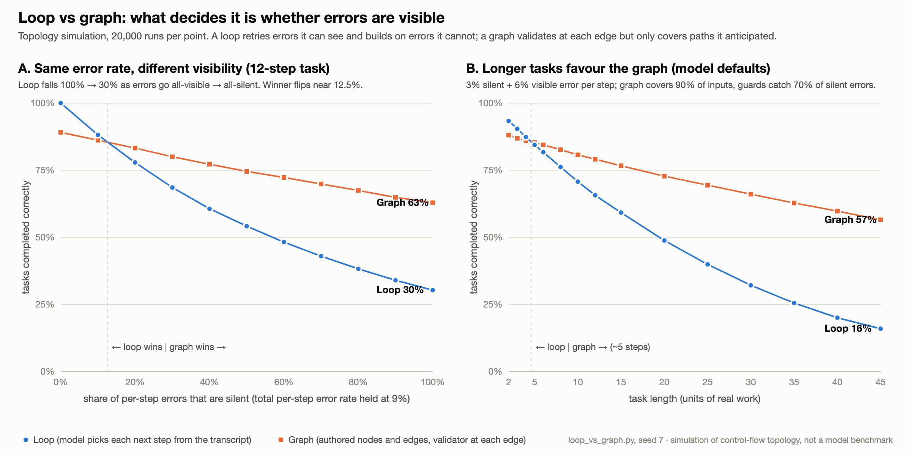

# loop-vs-graph

A small simulation of one design question: when should an LLM agent run as an
open **loop** (the model picks each next step from its transcript) and when as
an authored **graph** (nodes and edges written ahead of time, with a validator
on each edge)?

The essay that goes with this code:
**[Your agent's error rate doesn't decide loop vs graph. Its error visibility does.](https://lymnal.github.io/loop-vs-graph/)**



## What it shows

- **Same error rate, different visibility.** Hold the per-step error rate at 9%
  on a 12-step task. If every error is visible (an exception, a failing test),
  the loop finishes correctly 100% of the time. If every error is silent (the
  step looks fine and is wrong), it finishes 30% of the time. The graph goes
  from 89% to 63% over the same range. The winner flips when roughly one error
  in eight is silent.
- **Longer tasks favour the graph.** At the default settings the crossover sits
  near 5 steps. At 45 steps the loop finishes 16% of the time and the graph 57%.
- **Token cost is arithmetic.** A loop's transcript is its state, so input
  tokens grow with the square of the step count: about 5× a graph at 12 steps
  and 29× at 80. Prompt caching divides the constant and leaves the growth
  rate alone.

## What it is not

This is a model of control-flow topology. It is not a benchmark of any model,
and every rate in it is an assumption you can read in `Params` at the top of
`loop_vs_graph.py`. The headline follows from one of those assumptions: a
silent error poisons the rest of the run, and a visible one costs a retry.
Change the assumptions and the conclusions move, which is the reason to have
them written down as code.

## Run it

Python 3, standard library only (tested on 3.9). The seed is fixed at 7 and
the outputs are committed, so you can diff your run against mine.

```bash
python3 loop_vs_graph.py > sim_output.txt
python3 check_sensitivity.py > check_sensitivity_output.txt
python3 fig_data.py && python3 make_figure.py
```

Each line takes about ten seconds on a laptop. The figure data uses 20,000
runs per point.

## Files

| file | what it is |
|---|---|
| `loop_vs_graph.py` | the model: token cost, reliability, crossover table, latency, path variance, sensitivity |
| `sim_output.txt` | its output |
| `check_sensitivity.py` | re-checks of the sensitivity ranking, using the model's own functions |
| `check_sensitivity_output.txt` | its output |
| `fig_data.py` | computes the two figure panels into the CSVs |
| `fig_panelA_visibility.csv`, `fig_panelB_length.csv` | figure data |
| `make_figure.py` | draws `fig-loop-vs-graph.svg` from the CSVs, no plotting library |
| `fig-loop-vs-graph.png` | the same figure at 2400×1200 |

## Two things the re-checks changed

`loop_vs_graph.py` prints a sensitivity table (section 6) that ranks the retry
budget first and guard quality fifth of six. `check_sensitivity.py` shows why
that ranking should not be read at face value:

- Retries top the table only because the low end of the range is zero, where a
  graph cannot recover from any error. Move every knob by the same relative
  amount and the silent-error rate ranks first (section E).
- Guard quality matters more the longer the task: a 9-point swing at 5 steps,
  49 points at 45 (section B).
- Context rot barely matters at 12 steps because the loop's context is only
  about 18,000 tokens by then. With a harsher rot assumption and 20 to 30
  steps it is a 16 to 23 point knob (sections C and D).

The model script is left as it was first written, table included, so the
correction is visible next to the thing it corrects.

## Not in this repository

The essay also reports numbers from mining my own coding-agent transcripts for
steps worth turning into edges. That miner is not here yet: it is tied to my
own setup and its output names my tools. If you want to run it on your traces
before I publish a clean version, open an issue or email me.

## Corrections

Counterexamples and corrections are welcome: open an issue, or email
esam5556@gmail.com.

## License

MIT. See [LICENSE](LICENSE).
